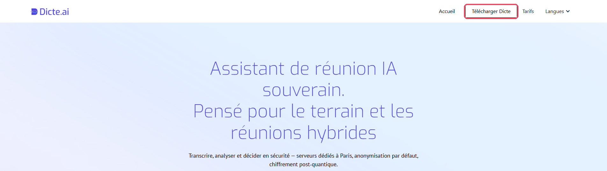
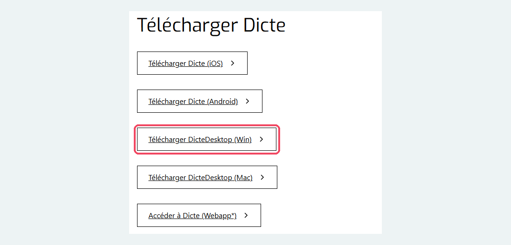
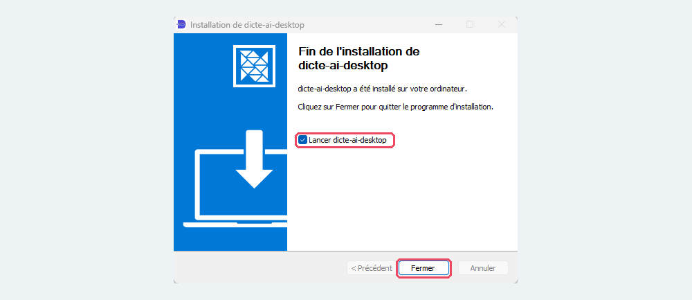
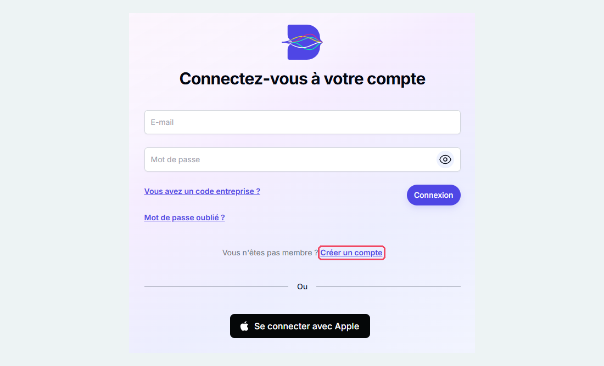
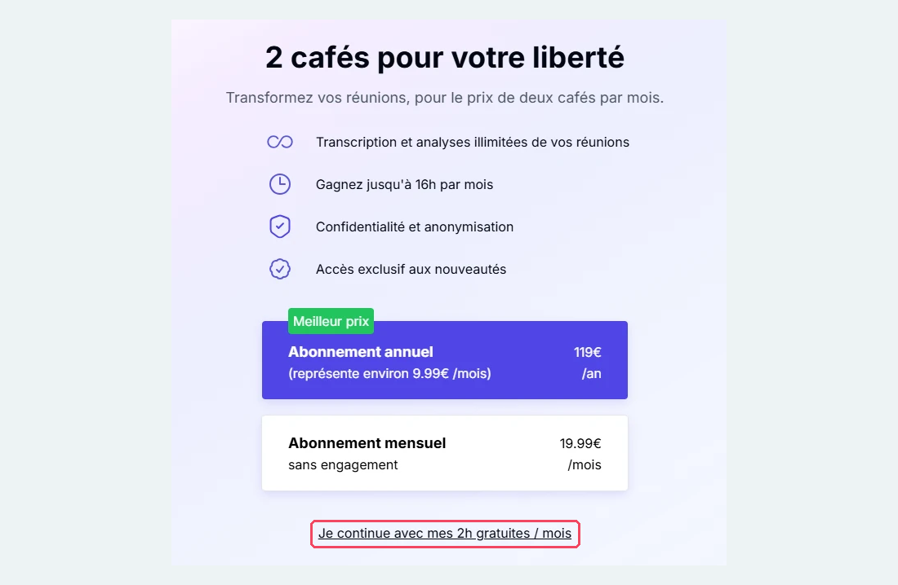
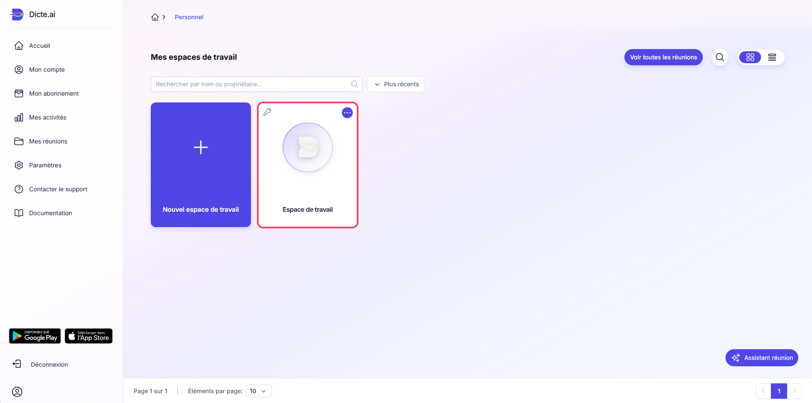
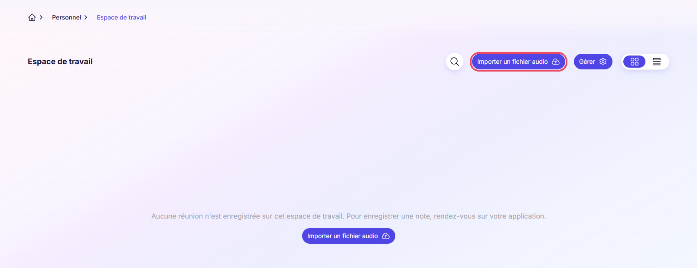

# Dicte.ai

Entreprise UE Version gratuite

Dernière vérification : octobre 2026

**Dicte.ai** est un assistant de réunion français (société Livdeo, à Besançon) qui **enregistre une réunion en présentiel**, la **transcrit** et **génère directement un compte rendu**. Pratique pour une réunion autour d'une table, une visite de terrain ou une soutenance, quand il n'y a pas de visio. Il existe sur **téléphone** (iPhone et Android), sur **ordinateur** (Windows et Mac) et dans le **navigateur**. Selon l'éditeur, les données sont traitées sur des **serveurs dédiés à Paris**, avec une **anonymisation par défaut**.

[Ouvrir Dicte.ai](https://dicte.ai){ .md-button .md-button--primary }

## À quoi ça sert dans le supérieur

- **Rédiger le compte rendu d'une réunion en présentiel** : réunion d'équipe, conseil de département, point de projet.
- **Garder une trace d'une visite de terrain** : visite d'entreprise, de chantier ou de laboratoire avec des étudiants.
- **Gagner du temps** : le compte rendu est proposé dès la fin de l'enregistrement, il ne reste qu'à le relire.
- **Transcrire un enregistrement déjà réalisé** (dictaphone, téléphone) en l'important dans l'espace de travail.

## Version gratuite

Dicte.ai est **gratuit jusqu'à 2 heures de réunion par mois**, sur téléphone, ordinateur ou navigateur. Au-delà, un **abonnement payant** est nécessaire (19,99 € par mois ou 119 € par an) : il n'est pas utile pour un usage ponctuel. Après la création du compte, Dicte propose ces abonnements : il suffit de choisir la version gratuite (voir le pas à pas).

## Cas d'usage

=== "Réunion d'équipe"

    **Exemple** : la réunion de rentrée de l'équipe pédagogique d'un département de génie civil.

    Posez le téléphone au centre de la table, lancez l'enregistrement, puis relisez et corrigez le compte rendu généré avant de le diffuser.

=== "Visite de terrain"

    **Exemple** : la visite d'un chantier avec une promotion de 2e année.

    Enregistrez les explications du conducteur de travaux, puis utilisez le compte rendu comme base d'un document de synthèse pour les étudiants.

## Pas à pas

:material-magnify-plus-outline: Cliquez sur une capture pour l'agrandir.
{ .astuce-zoom }

### 1 Télécharger Dicte

1. Ouvrez le site [dicte.ai](https://dicte.ai/fr-fr), puis cliquez sur **Télécharger Dicte**, en haut à droite.

    

2. Choisissez la version qui correspond à votre appareil :
    - **Télécharger Dicte (iOS)** ou **Télécharger Dicte (Android)** pour un téléphone, à poser au centre de la table pendant la réunion ;
    - **Télécharger DicteDesktop (Win)** ou **Télécharger DicteDesktop (Mac)** pour un ordinateur ;
    - **Accéder à Dicte (Webapp)** pour l'utiliser dans le navigateur, sans rien installer.

    

### 2 Installer l'application

Sur ordinateur, ouvrez le fichier téléchargé et suivez l'installation. À la fin, laissez cochée la case **Lancer dicte-ai-desktop**, puis cliquez sur **Fermer** : l'application s'ouvre.

Sur téléphone, l'installation se fait comme pour toute application, depuis l'App Store ou Google Play.

### 3 Créer un compte

1. Sur l'écran **Connectez-vous à votre compte**, cliquez sur **Créer un compte**, puis inscrivez-vous avec votre adresse e-mail de l'école.

    

2. Lisez les conditions d'utilisation, cochez **J'ai lu et j'accepte les conditions d'utilisation**, puis cliquez sur **Continuer**.

    

### 4 Choisir la version gratuite

Dicte vous propose ensuite un abonnement payant. Pour rester sur la version gratuite, cliquez sur **Je continue avec mes 2h gratuites / mois**, en bas de la page.

### 5 Ouvrir votre espace de travail

1. La page **Mes espaces de travail** s'affiche. Cliquez sur **Espace de travail**, créé automatiquement : c'est là que seront rangées vos réunions.

    

2. Pour transcrire un enregistrement déjà réalisé (dictaphone, téléphone), cliquez sur **Importer un fichier audio**. Pour enregistrer une réunion en direct, utilisez l'application sur téléphone ou sur ordinateur (étape suivante).

    

### 6 Enregistrer la réunion

1. Ouvrez l'application Dicte sur votre téléphone ou votre ordinateur, et connectez-vous avec votre compte.
2. Annoncez aux participants que la réunion est enregistrée.
3. Posez le téléphone (ou l'ordinateur) au centre de la table, puis lancez l'enregistrement avec le bouton du **micro**.
4. À la fin de la réunion, arrêtez l'enregistrement. L'enregistrement est envoyé dans votre espace de travail pour être transcrit.

Pensez à surveiller votre temps : la version gratuite est limitée à **2 heures par mois**.

### 7 Relire la transcription

Ouvrez la réunion dans votre espace de travail (par exemple dans **Mes réunions**). La transcription distingue les différents intervenants. Relisez-la et corrigez les erreurs, en particulier les noms propres, les sigles et le vocabulaire technique.

### 8 Générer le compte rendu

Depuis la réunion, demandez à Dicte de générer le compte rendu. Relisez-le attentivement : vérifiez que les décisions, les actions à mener et les échéances correspondent bien à ce qui a été dit, et complétez si besoin.

### 9 Partager ou exporter le compte rendu

Une fois le compte rendu validé, utilisez les options de partage ou d'export de la réunion pour l'envoyer aux participants ou l'enregistrer sur votre ordinateur. Vous pouvez ensuite le reprendre dans Word pour le mettre en forme.

Supprimez ensuite l'enregistrement s'il n'est plus utile.

## Ressources officielles

- [Dicte.ai](https://dicte.ai) : site officiel.

## Points de vigilance

!!! warning "Consentement des participants"
    Informez toujours les participants avant d'enregistrer et obtenez leur accord. Supprimez l'enregistrement de l'application une fois le compte rendu validé.

!!! warning "Données"
    Les enregistrements sont envoyés sur les serveurs de l'éditeur pour être transcrits. Vérifiez la politique de confidentialité dans l'application avant un premier usage. Pour une réunion sensible (jury, situation d'un étudiant), n'enregistrez pas : privilégiez une prise de notes classique.

!!! tip "Fiabilité"
    Relisez toujours le compte rendu généré : l'IA peut mal attribuer une parole, oublier un point ou reformuler une décision de façon inexacte.
