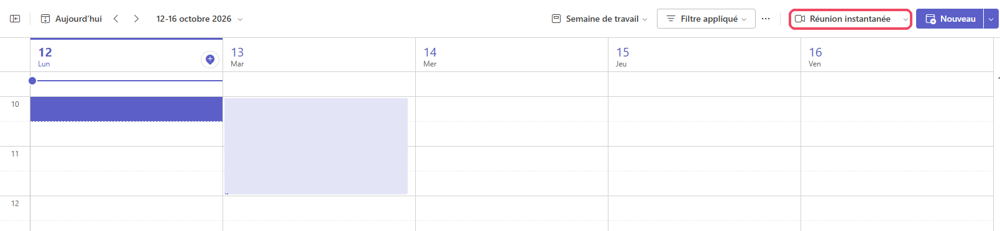
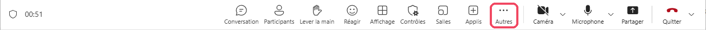
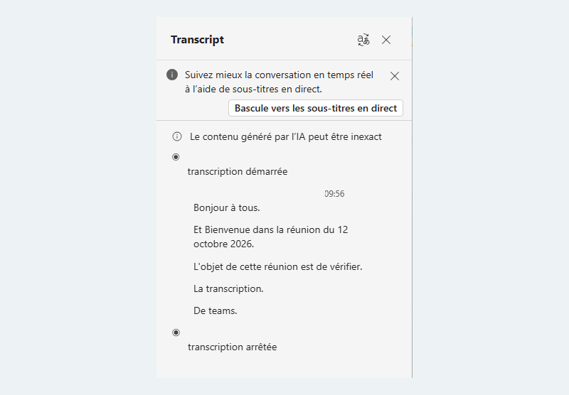
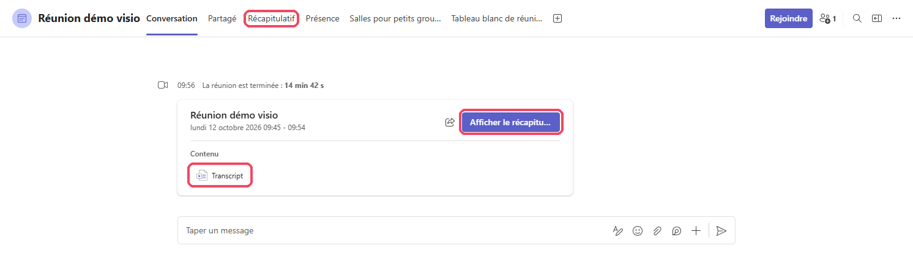
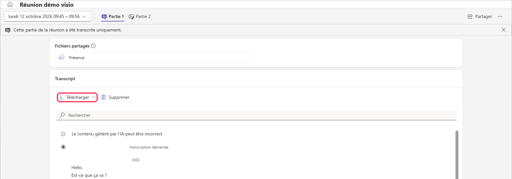

# Teams

<span class="badge badge-hors-ue">Hors UE</span> <span class="badge badge-gratuit">Inclus avec le compte enseignant</span>

<p class="maj">Dernière vérification : octobre 2026</p>

**Microsoft Teams**, l'outil de visioconférence de l'école, peut **transcrire une réunion en direct** : chaque intervention s'affiche par écrit, avec le nom de la personne qui parle. À la fin de la réunion, la transcription reste disponible et peut être téléchargée, puis utilisée pour rédiger le compte rendu. Tous les enseignants disposent de la suite Office (Microsoft 365) avec leur compte enseignant : la fonction est déjà disponible, rien à installer.

## À quoi ça sert dans le supérieur

- **Rédiger le compte rendu d'une réunion en visio** : réunion d'équipe pédagogique, comité de pilotage, réunion avec un partenaire à distance.
- **Savoir qui a dit quoi** : Teams indique le nom de chaque intervenant, grâce aux comptes des participants.
- **Permettre à un absent de prendre connaissance** de ce qui a été dit.

## Version gratuite

La transcription est **incluse** dans Teams avec votre compte enseignant (suite Office Microsoft 365) : aucun abonnement supplémentaire n'est nécessaire.

- La transcription est lancée par l'organisateur ou un participant de l'école ; **tous les participants sont prévenus** par un bandeau.
- Le **résumé automatique** de la réunion par Copilot (« récapitulatif intelligent ») est une fonction **payante**, non incluse : vous rédigerez le compte rendu vous-même ou avec un assistant IA (voir les cas d'usage).
- La transcription téléchargée s'ouvre dans **Word**, inclus dans la même suite Office : vous pouvez la relire et la corriger avant de rédiger le compte rendu.

## Cas d'usage

=== "Compte rendu de réunion"

    **Exemple** : une réunion en visio de l'équipe pédagogique d'un module de génie des procédés.

    Téléchargez la transcription, puis collez-la dans [ILaaS](../assistants/ilaas.md) ou [Mistral Vibe](../assistants/le-chat.md) avec cette consigne :

    ```
    Voici la transcription d'une réunion d'équipe pédagogique.
    Rédige un compte rendu structuré :
    - points abordés, avec un résumé de chacun ;
    - décisions prises ;
    - actions à mener, avec la personne responsable et l'échéance.
    Désigne les participants par leur fonction, sans leur nom.
    Reste fidèle à la transcription : n'ajoute aucune information.

    Transcription :
    [collez la transcription ici]
    ```

=== "Réunion avec un partenaire"

    **Exemple** : un point d'avancement en visio avec une entreprise qui accueille un projet étudiant.

    ```
    À partir de cette transcription, liste les engagements pris
    par chaque partie et les prochaines étapes, sous forme de
    tableau : action, responsable, échéance.

    Transcription :
    [collez la transcription ici]
    ```

## Pas à pas

:material-magnify-plus-outline: Cliquez sur une capture pour l'agrandir.
{ .astuce-zoom }

<div class="etape" markdown>

### <span class="etape-num">1</span> Lancer la réunion

Pour une réunion planifiée, rejoignez-la comme d'habitude depuis le **Calendrier**. Pour lancer une réunion tout de suite :

1. Cliquez sur **Calendrier**, dans la barre de gauche de Teams, puis sur **Réunion instantanée**, en haut à droite.

    

2. Dans **Nom de la réunion**, remplacez le nom proposé par un titre clair, par exemple « Équipe pédagogique génie des procédés – 12 octobre » : c'est grâce à lui que vous retrouverez la transcription.
3. Cliquez sur **Commencer la réunion**.

    

</div>

<div class="etape" markdown>

### <span class="etape-num">2</span> Démarrer la transcription

1. Dans la barre d'outils de la réunion, cliquez sur **Autres**.
2. Pointez **Enregistrer et transcrire**, puis cliquez sur **Démarrer la transcription** dans le sous-menu qui s'ouvre.
3. Si Teams vous le demande, vérifiez la **langue parlée** pendant la réunion (par exemple **Français**), puis confirmez.

Tous les participants sont prévenus par un message que la réunion est transcrite.



</div>

<div class="etape" markdown>

### <span class="etape-num">3</span> Suivre la transcription

Le volet **Transcript** s'ouvre à droite de la fenêtre. Chaque intervention s'y affiche avec le **nom de la personne** qui parle et l'**heure**. Teams rappelle que le contenu généré par l'IA peut être inexact.

Vous pouvez fermer ce volet avec la croix : la transcription continue en arrière-plan.



</div>

<div class="etape" markdown>

### <span class="etape-num">4</span> Arrêter la transcription

1. Cliquez de nouveau sur **Autres**.
2. Pointez **Enregistrer et transcrire**, puis cliquez sur **Arrêter la transcription**.

Le message **La transcription a pris fin** s'affiche. Vous pouvez la redémarrer à tout moment. Si vous quittez la réunion sans l'arrêter, la transcription s'arrête automatiquement.


</div>

<div class="etape" markdown>

### <span class="etape-num">5</span> Retrouver la transcription après la réunion

1. Cliquez sur **Conversation**, dans la barre de gauche de Teams, puis sur la conversation qui porte le **nom de la réunion**. L'emplacement exact dépend de la façon dont la réunion a été lancée : voir [le tableau ci-dessous](#retrouver-une-transcription-apres-la-reunion).
2. Un encart résume la réunion terminée. Cliquez sur **Afficher le récapitulatif** (ou sur l'onglet **Récapitulatif**, en haut).

    Vous pouvez aussi cliquer sur **Transcript**, dans la partie **Contenu** de l'encart, pour lire directement la transcription.



</div>

<div class="etape" markdown>

### <span class="etape-num">6</span> Télécharger la transcription

Dans la fenêtre du récapitulatif, la partie **Transcript** affiche toute la transcription.

1. Cliquez sur **Télécharger**.
2. Le fichier est téléchargé au format **.docx** : il s'ouvre dans Word, avec le nom des intervenants et l'heure de chaque intervention.

Si la transcription a été arrêtée puis relancée pendant la réunion, elle est découpée en plusieurs parties (**Partie 1**, **Partie 2**…) : téléchargez chacune d'elles.

Le bouton **Supprimer** efface la transcription : pensez-y une fois le compte rendu rédigé.



</div>

## Retrouver une transcription après la réunion

La transcription reste disponible après la fin de la réunion, mais **son emplacement dépend de la façon dont la réunion a été lancée** :

| Comment la réunion a été lancée | Où retrouver la transcription |
|---|---|
| **Réunion planifiée** dans le **Calendrier** de Teams ou depuis Outlook | **Conversation** : ouvrez la conversation qui porte le nom de la réunion. La transcription n'apparaît **pas** dans le Calendrier. |
| **Réunion instantanée** (**Réunion instantanée** dans le Calendrier) | **Conversation** : ouvrez la conversation qui porte le nom de la réunion. |
| **Réunion lancée depuis une conversation** de groupe | Dans **cette même conversation**, à la suite des messages. |
| **Réunion lancée dans le canal d'une équipe** | Dans le **canal** de l'équipe, dans la publication de la réunion. |

Dans tous les cas, vous pouvez aussi taper le nom de la réunion dans la barre de **Recherche**, en haut de Teams.

!!! tip "Deux bons réflexes"
    - **Donnez un titre clair** à la réunion (par exemple « Équipe pédagogique génie des procédés – 12 octobre ») : vous la retrouverez plus facilement.
    - **Téléchargez la transcription juste après la réunion** : elle n'est conservée que pendant une durée limitée, fixée par l'école.

## Ressources officielles

- [Démarrer, arrêter et télécharger des transcriptions en direct dans les réunions Teams](https://support.microsoft.com/fr-fr/office/d%C3%A9marrer-arr%C3%AAter-et-t%C3%A9l%C3%A9charger-des-transcriptions-en-direct-dans-les-r%C3%A9unions-microsoft-teams-dc1a8f23-2e20-4684-885e-2152e06a4a8b) : aide officielle de Microsoft.

## Points de vigilance

!!! warning "Consentement des participants"
    Annoncez la transcription en début de réunion, même si Teams affiche un bandeau d'information. Chaque participant peut choisir de masquer son nom dans la transcription.

!!! warning "Données"
    La transcription est réalisée et stockée par Microsoft (hors Union européenne). Pour une réunion sensible (jury, situation d'un étudiant), n'activez pas la transcription : privilégiez une prise de notes classique.

!!! tip "Fiabilité"
    Relisez la transcription avant de l'utiliser : les noms propres, les sigles et le vocabulaire technique sont souvent mal transcrits, surtout quand plusieurs personnes parlent en même temps.
