# Wooclap

<span class="badge badge-ue">Entreprise UE</span> <span class="badge badge-gratuit">Licence de l'école</span>

<p class="maj">Dernière vérification : à compléter</p>

**Wooclap** est une plateforme de questions interactives : pendant votre cours, les étudiants répondent depuis leur téléphone ou leur ordinateur, et les résultats s'affichent en direct. L'école dispose d'une licence, et vous vous connectez avec votre compte de l'école. Depuis peu, cette licence donne aussi accès aux **agents IA de Wooclap**, des assistants intégrés qui vous aident à créer des questions, à rendre un schéma interactif ou à analyser les réponses de vos étudiants.

[Ouvrir Wooclap](https://www.wooclap.com){ .md-button .md-button--primary }

!!! info "Fiche en cours de rédaction"
    Le tutoriel complet sera bientôt disponible.

## À quoi ça sert dans le supérieur

- **Créer en quelques secondes des questions** (QCM, questions ouvertes, textes à trous, appariements…) à partir de votre support de cours.
- **Rendre un schéma interactif** : les étudiants placent eux-mêmes les légendes d'un schéma technique.
- **Vérifier la compréhension en direct** et adapter la suite du cours aux réponses.
- **Faire émerger et classer les idées** d'un amphithéâtre lors d'un remue-méninges.
- **Faire une synthèse** des réponses ouvertes des étudiants à la fin d'une séance.

## Accès et licence

Wooclap est accessible **avec votre compte de l'école**, grâce à la licence souscrite par l'établissement : vous n'avez rien à payer. Les **agents IA** sont réservés aux établissements qui ont souscrit l'option IA (ou qui la testent) et aux abonnements Pro. Wooclap s'engage à ce qu'**aucun modèle d'IA ne soit entraîné avec vos données**, respecte le RGPD et héberge les données en Europe.

## Les agents IA de Wooclap

| Agent | À quoi il sert |
|---|---|
| **Générateur de questions** | Créer des questions en quelques secondes à partir d'un document (PDF, PowerPoint), d'un lien, d'un texte collé ou d'un fichier audio ou vidéo |
| **Image Labeler** | Transformer un schéma ou une carte en activité interactive, en plaçant automatiquement les repères et en masquant les légendes |
| **Answer Organizer** | Classer automatiquement les réponses des participants par thèmes |
| **Idea Generator** | Proposer des réponses à une question de remue-méninges |
| **Summarizer** | Structurer et résumer les contributions des participants |

<!-- Intitulés français des agents à vérifier sur les captures -->

## Cas d'usage

=== "Questions à partir d'un cours"

    **Exemple** : un QCM de fin de séance sur un chapitre de résistance des matériaux.

    Avec **Créer à l'aide de l'IA**, importez votre support de cours (PDF ou PowerPoint), puis indiquez dans **Instructions supplémentaires** :

    ```
    Génère 6 questions à choix multiples sur ce chapitre,
    pour des élèves ingénieurs de 1re année : 3 questions de
    compréhension des notions (contrainte, déformation, module
    d'Young) et 3 questions d'application numérique simples.
    Une seule bonne réponse par question, avec des
    distracteurs fondés sur les erreurs fréquentes.
    ```

=== "Schéma à légender"

    **Exemple** : le schéma d'une pompe centrifuge en mécanique des fluides.

    Importez le schéma dans l'agent qui place les repères : il masque les légendes, et les étudiants doivent replacer chaque élément (roue, volute, aspiration, refoulement) pendant le cours.

=== "Analyser les réponses"

    **Exemple** : une question ouverte en début de cours de développement durable.

    Posez la question « Citez un exemple de gaspillage d'énergie que vous avez observé sur le campus », puis utilisez l'agent qui **classe les réponses par thèmes** : vous voyez immédiatement les sujets qui reviennent le plus, et vous pouvez en partir pour la suite du cours.

=== "Synthèse de fin de séance"

    **Exemple** : la fin d'un TD de gestion de projet.

    Posez la question « Qu'est-ce qui reste flou pour vous après cette séance ? », puis demandez à l'agent de **synthèse** de résumer les réponses : vous savez quoi reprendre au début de la séance suivante.

## Pas à pas

:material-magnify-plus-outline: Cliquez sur une capture pour l'agrandir.
{ .astuce-zoom }

<div class="etape" markdown>

### <span class="etape-num">1</span> Se connecter avec le compte de l'école

1. Ouvrez [wooclap.com](https://www.wooclap.com/fr/), puis cliquez sur **Se connecter**, en haut à droite.

    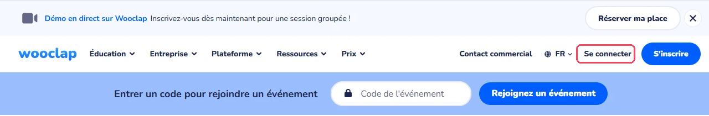

2. Sur l'écran **Authentification unique (SSO)**, saisissez votre adresse e-mail de l'école dans le champ **Email**, puis cliquez sur **Continuer avec l'authentification unique**.
3. Connectez-vous avec vos identifiants habituels de l'école.

N'utilisez pas **Se connecter sans SSO** : seul le compte de l'école donne accès à la licence et aux agents IA.

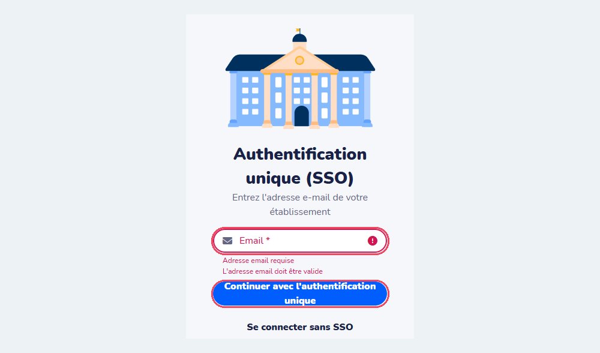

</div>

<div class="etape" markdown>

### <span class="etape-num">2</span> Découvrir le tableau de bord

La page d'accueil propose en haut des **modèles** d'événements, puis la liste **Mes événements**. Un bandeau indique que **les agents IA sont disponibles sur votre compte**. Pour préparer une séance, cliquez sur **Créer un événement**.

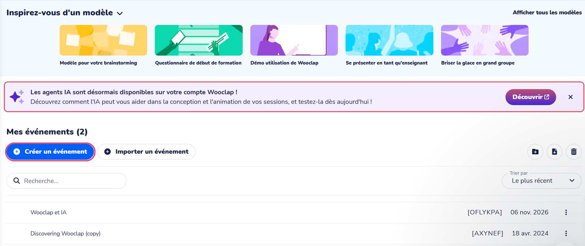

</div>

<div class="etape" markdown>

### <span class="etape-num">3</span> Créer un événement

Un **événement** regroupe les questions d'une séance.

1. Cliquez sur **Mon nouvel événement**, en haut à gauche, et remplacez-le par le titre de votre séance (par exemple « Architecture des solides parfaits »).
2. Laissez l'onglet **Session en direct** sélectionné : les questions seront posées pendant le cours.
3. Cliquez sur **Créer une question**.

Le bouton **Démarrer l'événement**, en haut à droite, servira à lancer la séance (étape 7).

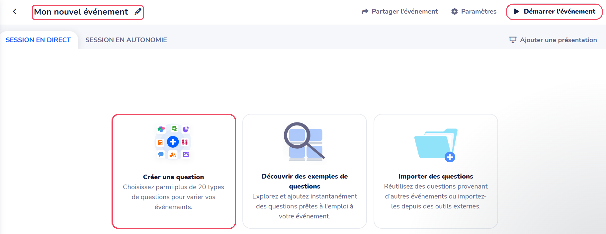

</div>

<div class="etape" markdown>

### <span class="etape-num">4</span> Générer des questions avec l'IA à partir d'un document

1. Dans la liste des types de questions, cliquez sur **Créer à l'aide de l'IA**, dans la rubrique **En vedette**.

    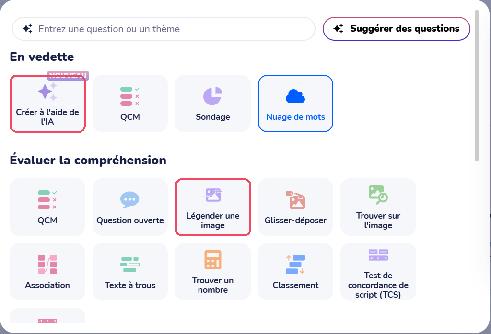

2. À la question **Depuis quelle source souhaitez-vous générer des questions ?**, cliquez sur **Document**. Les autres sources possibles sont **Texte**, **Thématique**, **YouTube**, **Lien** et **Audio/vidéo**.

    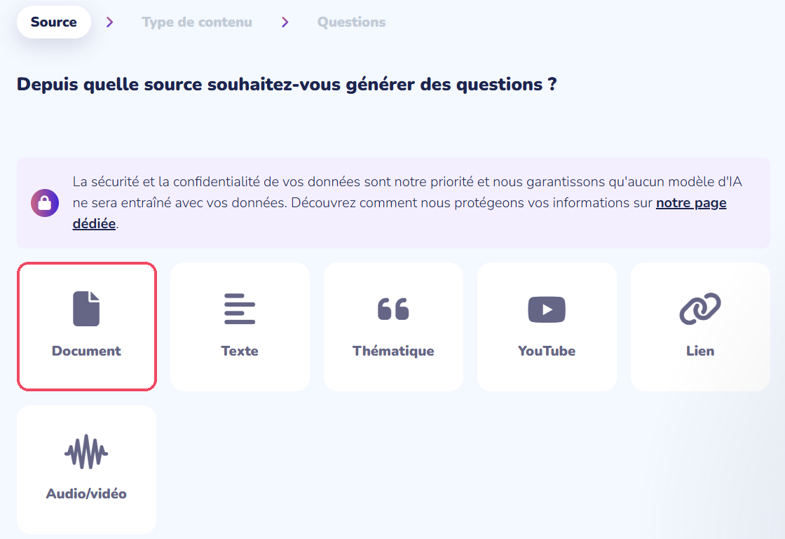

3. Déposez votre support de cours (PDF ou PowerPoint) dans le cadre. Si besoin, limitez la génération à certaines pages avec **Affinez votre contenu en choisissant les pages pertinentes**. Pour un document scanné ou une photo, cochez **Mon PDF est un document scanné…**. Cliquez ensuite sur le bouton pour passer à l'étape suivante.

    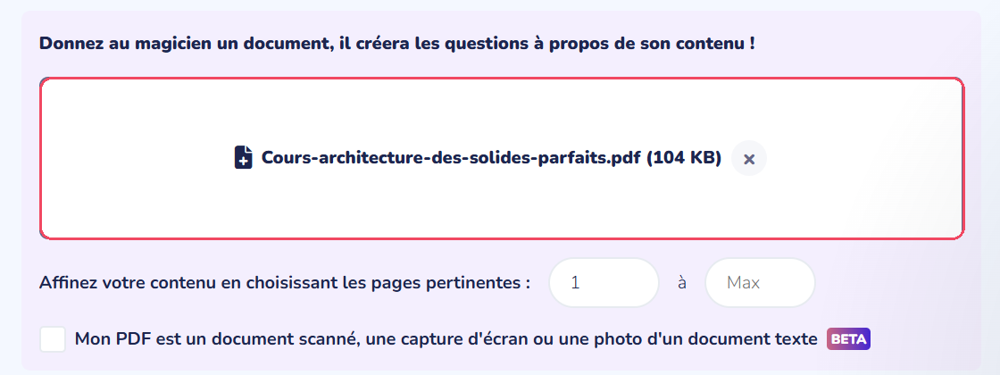

4. À **Quel type de contenu souhaitez-vous créer ?**, cochez un ou plusieurs types : **Questions à choix multiple**, **Sondage**, **Questions ouvertes**, **Textes à trous**, **Associations** ou **Brainstorming**. Pour certains types, précisez le nombre d'éléments, par exemple le **Nombre de réponses correctes** et le **Nombre de réponses fausses** d'un QCM.
5. Dépliez **(facultatif) Instructions supplémentaires** pour préciser votre public et vos attentes (voir l'exemple dans les cas d'usage), puis cliquez sur **Générer le contenu**.

    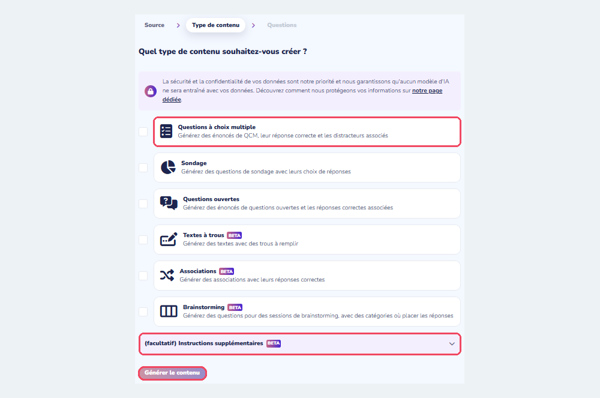

</div>

<div class="etape" markdown>

### <span class="etape-num">5</span> Relire et modifier les questions générées

Les questions générées s'affichent les unes sous les autres. **Relisez chacune d'elles** avant de l'ajouter à votre événement :

1. Cochez ou décochez les cases pour indiquer les **bonnes réponses**.
2. Cliquez dans une proposition pour la corriger, ou sur la **corbeille** pour la supprimer.
3. Ajoutez au besoin vos propres éléments avec **Ajouter une proposition manuellement** ou **Ajouter une question manuellement**.

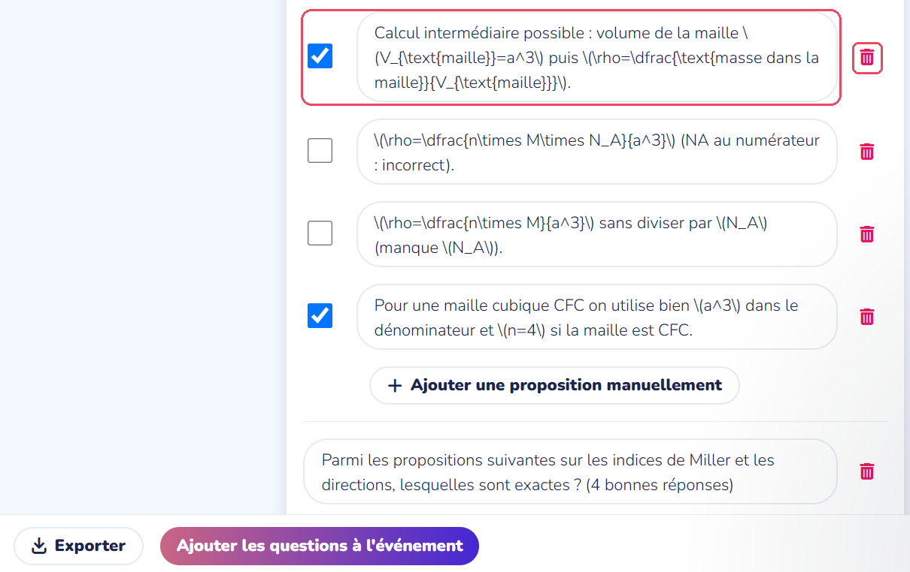

!!! warning "Attention aux formules"
    Pendant la relecture, les formules mathématiques s'affichent sous forme de code (par exemple `\(\rho=\dfrac{n\times M}{a^3}\)`). Une fois les questions ajoutées à l'événement, la plupart deviennent des formules lisibles, mais pas toutes. Vérifiez chaque question dans la liste de l'événement (étape 7) et réécrivez en texte simple celles qui restent sous forme de code, par exemple « ρ = n × M / (N_A × a³) ».

Quand tout est relu, cliquez sur **Ajouter les questions à l'événement**, en bas de la page. **Générer plus de contenu sur la même section** propose d'autres questions, et **Exporter** les enregistre dans un fichier.

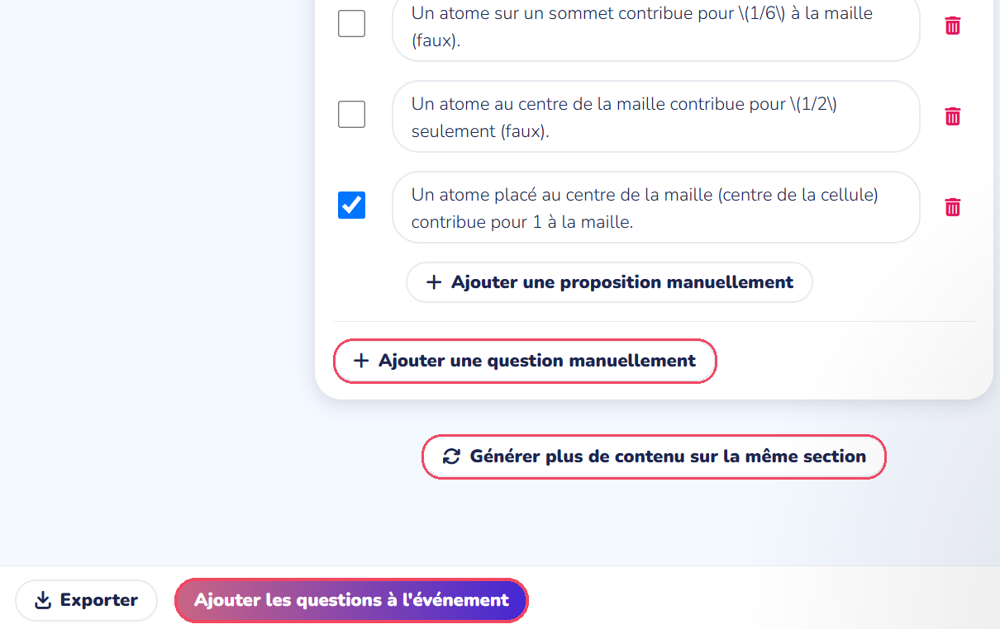

</div>

<div class="etape" markdown>

### <span class="etape-num">6</span> Rendre un schéma interactif

Les étudiants retrouvent les légendes masquées d'un schéma technique.

1. Dans l'événement, cliquez sur **Créer une question**, puis sur **Légender une image**, dans la rubrique **Évaluer la compréhension** (voir la capture de l'étape 4).
2. Dans **Titre de la question**, écrivez la consigne, par exemple « Replacez chaque légende sur le schéma de la maille CFC ».
3. Chargez votre schéma dans la partie **Image**.
4. Si le schéma comporte déjà ses légendes, cliquez sur **Auto-légender cette image** : l'IA repère les légendes, place les repères numérotés et masque le texte. Sinon, cliquez sur l'image pour placer chaque repère, puis saisissez la réponse attendue dans **Étiquette 1**, **Étiquette 2**… (bouton **Nouvelle étiquette**).
5. Vérifiez les repères et les étiquettes : l'IA peut se tromper. Dans l'exemple ci-dessous, elle a fusionné le titre du schéma et la légende « Arête du cube » dans l'étiquette 1 : il faut corriger l'étiquette et déplacer le repère. **Flouter une zone de l'image** permet de masquer une partie restée visible.

    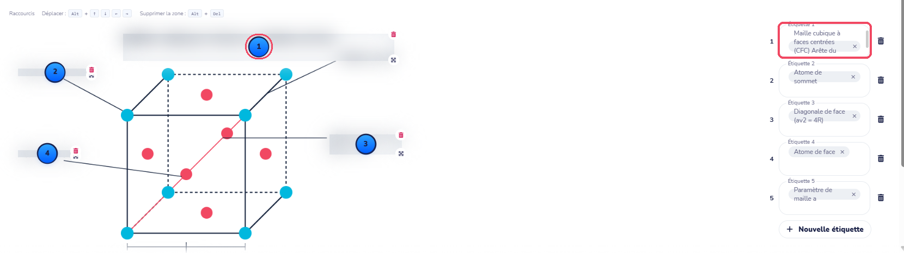

6. Dans le panneau de droite, laissez **Ignorer les petites erreurs** activé : les erreurs d'accents et de majuscules ne seront pas pénalisées.
7. Cliquez sur **Sauvegarder**, ou sur **Afficher maintenant** pour poser la question tout de suite.

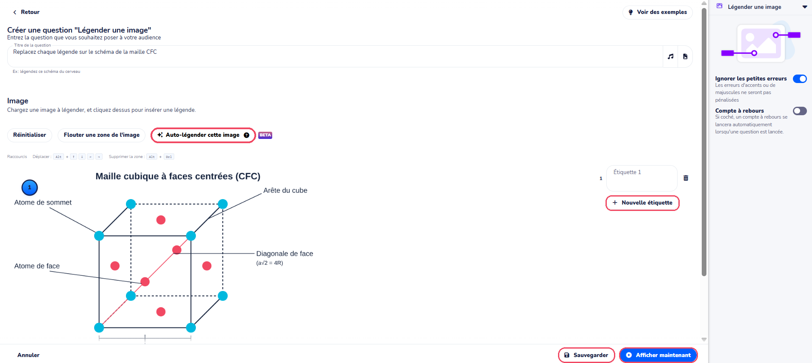

</div>

<div class="etape" markdown>

### <span class="etape-num">7</span> Lancer l'événement pendant le cours

1. La page de l'événement liste toutes vos questions. Vérifiez-les et corrigez-les si besoin avec **Modifier**.
2. Pendant le cours, cliquez sur **Démarrer l'événement**, en haut à droite, pour projeter l'événement.
3. Commencez par la ligne **Rejoindre cet événement Wooclap** (bouton **Afficher**) : elle affiche le code et le QR code que les étudiants utilisent pour se connecter.
4. Affichez ensuite les questions une à une avec leur bouton **Afficher**.

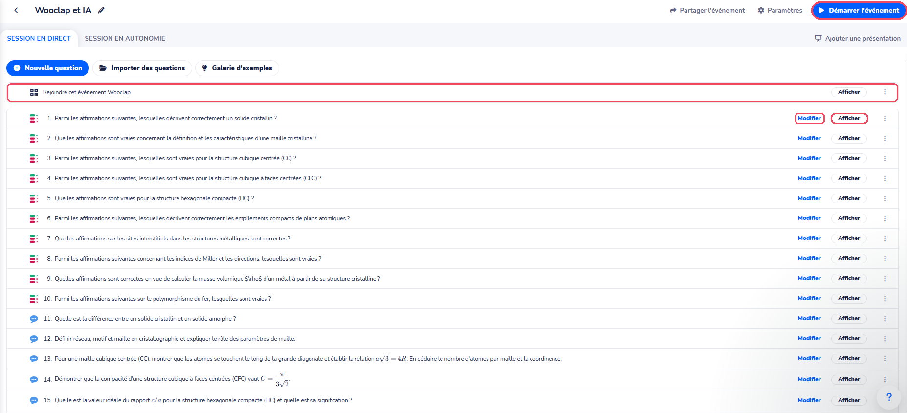

Les étudiants répondent depuis leur téléphone ou leur ordinateur, sans compte, en saisissant le code sur [wooclap.com](https://www.wooclap.com/fr/). Pour la question **Légender une image**, ils tapent le nom de chaque repère numéroté, puis cliquent sur **Valider** :

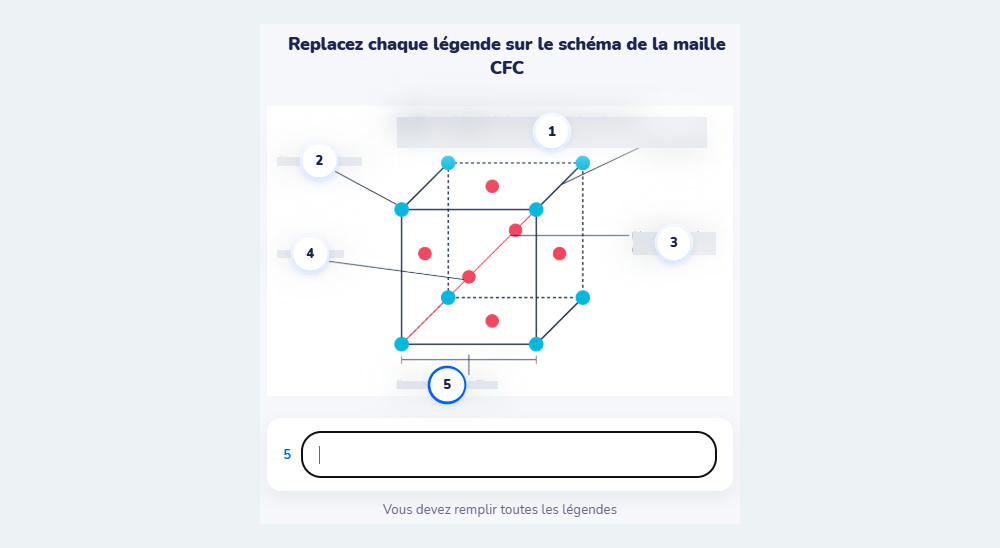

</div>

<div class="etape" markdown>

### <span class="etape-num">8</span> Retrouver les résultats

1. Sur la page de l'événement, cliquez sur **Paramètres**, en haut à droite.
2. Dans la rubrique **Résultats**, cliquez sur **Rapports** : les réponses de chaque question s'y trouvent.

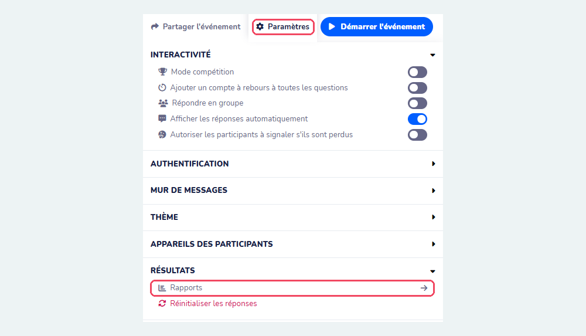

</div>

<!--
Captures encore utiles :
 - écran projeté après Démarrer l'événement (code et QR code)
 - classement et synthèse des réponses par l'IA (question ouverte)
-->

## Ressources officielles

- [Centre d'aide de Wooclap](https://docs.wooclap.com/fr/) : prise en main, types de questions, intégrations.
- [Les agents IA de Wooclap](https://docs.wooclap.com/fr/articles/11872838-agents-ia-de-wooclap) : présentation des agents, accès, confidentialité.
- [Générateur de questions](https://docs.wooclap.com/fr/articles/8774298-generateur-de-questions) : créer des questions à partir d'un document.

## Points de vigilance

!!! warning "Données"
    Wooclap est une entreprise belge : les données sont hébergées en Europe, et Wooclap s'engage à ne pas entraîner de modèles d'IA avec vos contenus. Évitez malgré tout de déposer des documents confidentiels, et ne demandez jamais aux étudiants de répondre avec des informations personnelles.

!!! tip "Fiabilité"
    Relisez chaque question générée par l'IA : la bonne réponse, les distracteurs et la formulation. Une question ambiguë en direct fait perdre du temps et peut induire les étudiants en erreur.

!!! info "Licence de l'école"
    Connectez-vous toujours avec votre compte de l'école, et non avec un compte personnel : c'est lui qui donne accès à la licence et aux agents IA.

!!! note "L'IA prépare, vous animez"
    Les agents IA accélèrent la préparation et l'analyse, mais le choix des questions, le moment où les poser et l'exploitation des réponses restent votre travail pédagogique.
